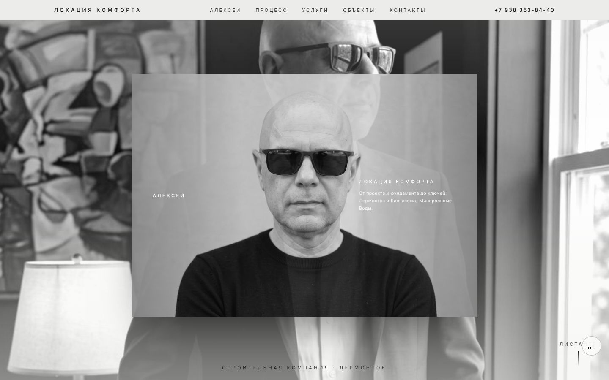
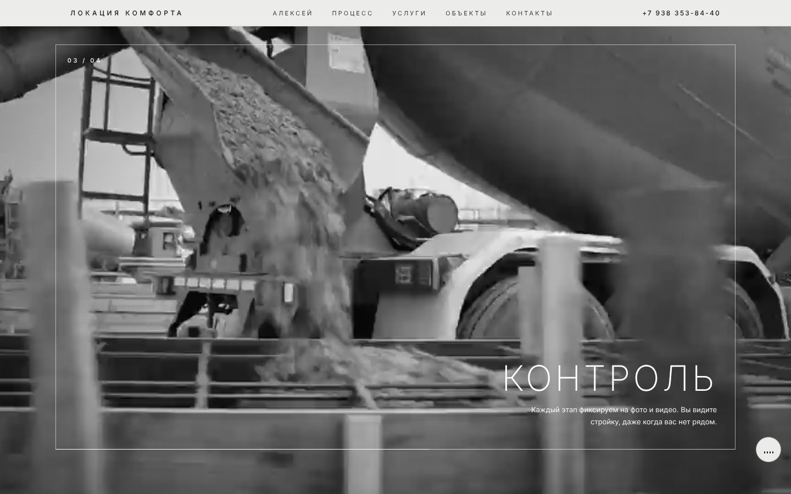
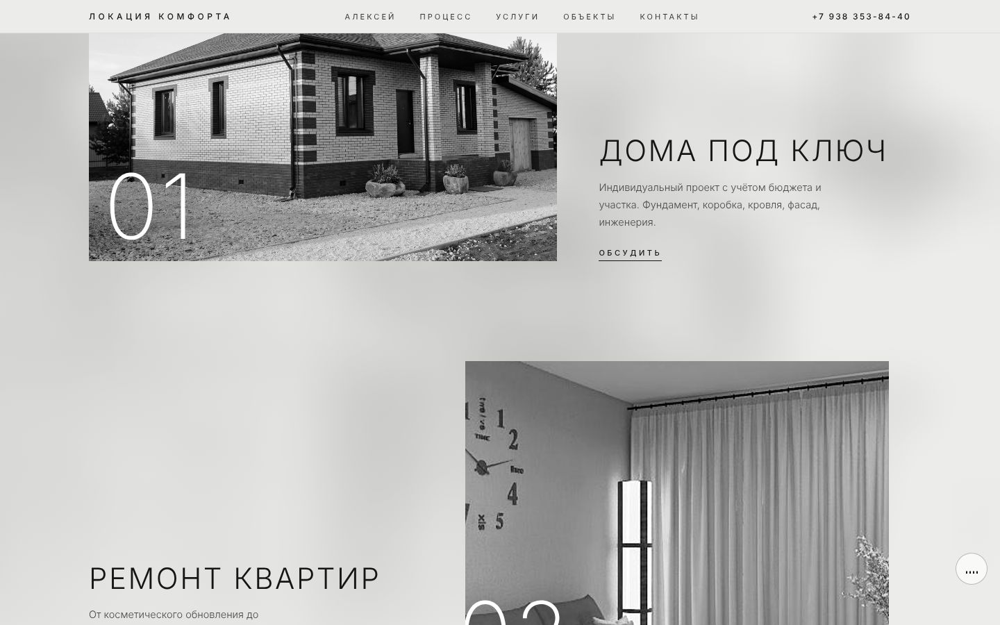
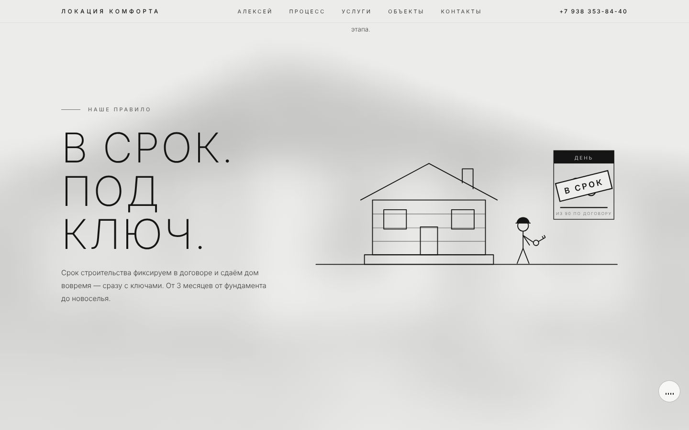
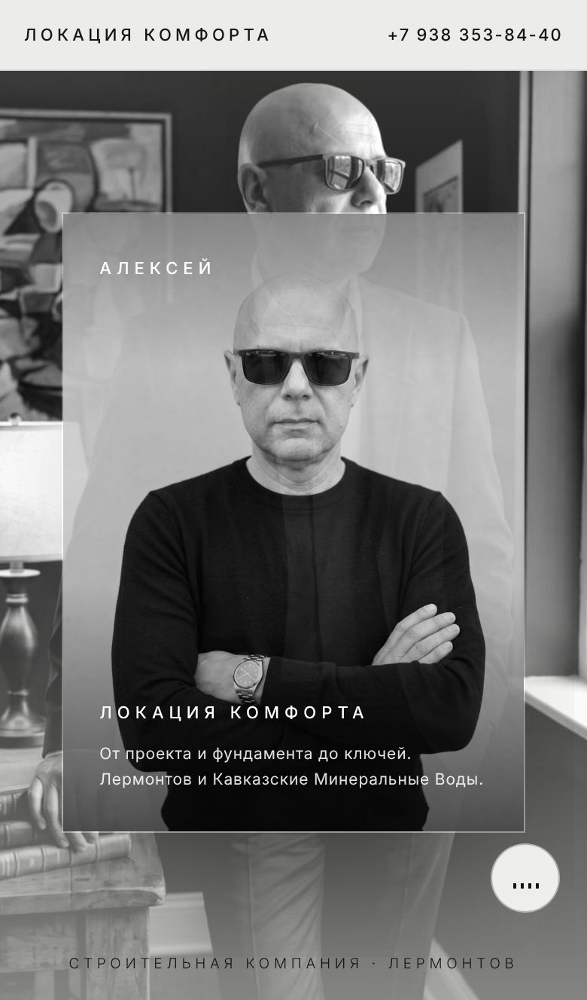
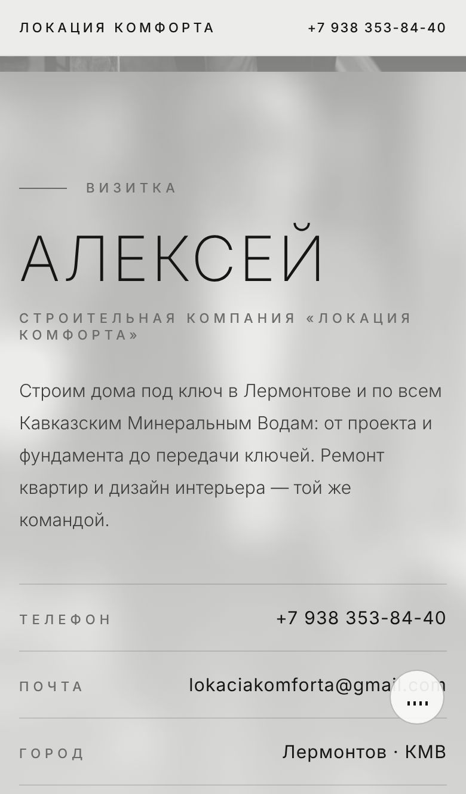

# Сайт-визитка «Локация Комфорта» — Алексей

Пример работы: электронная визитка руководителя строительной компании из Лермонтова (КМВ).
Человек подносит NFC-карточку к телефону — открывается этот сайт.

## Задача
У компании был бесплатный сайт на Wix: шаблонный, с ошибками в тексте (латинские буквы внутри русских слов,
слова с пробелами, битые ссылки), любительские фото. Нужно было сделать дорогую, строгую визитку человека в костюме,
а не очередной сайт стройкомпании.

## Что сделано
- **Стиль** — монохром: белый фон, чёрно-белые фото слоями, тонкий шрифт Montserrat, заглавные с разрядкой.
- **Первый экран** — на весь экран портрет в костюме; через 2 секунды после загрузки на него выплывает
  полупрозрачная карточка со вторым портретом.
- **Визитка** — имя, телефон, почта, город и четыре главных обещания сразу после первого экрана.
- **Бетон от прокрутки** — sticky-блок с видео: листаешь вниз, бетон льётся из миксера в опалубку.
  Отдельное видео для телефона (9:16) и компьютера (16:9), закодировано в ч/б с ключевым кадром на каждом кадре,
  чтобы перемотка по прокрутке была плавной.
- **Услуги** — крупные фото раскрываются из узкой рамки на весь кадр по мере прокрутки.
- **Четыре шага** — линия прорисовывается при прокрутке, точки загораются по очереди.
- **Мультик «В срок. Под ключ.»** — SVG-анимация: стикмен-строитель, дом рисуется линиями,
  календарь до 90 дней и штамп «В СРОК».
- **Музыка** — фоновая, включается с первого касания (браузеры запрещают автозвук), кнопка звука.
- **Фото** — портреты, фото команды и домов доработаны ИИ (Higgsfield / Nano Banana), видео — Kling 3.0.

| Видео от прокрутки | Услуги | В срок |
|---|---|---|
|  |  |  |

| Телефон | Визитка на телефоне |
|---|---|
|  |  |

## Файлы
- `mono.html` — сайт-визитка (основная версия).
- `alexey.html` — компактная карточка-визитка с кнопкой «Сохранить в контакты».
- `index.html` — первая, цветная версия редизайна.
- `build-v.mp4`, `build-h.mp4` — видео для прокрутки; `music.mp3` — музыка; `*.jpg` — фото.
- `tools/build_standalone.py` — собирает `mono.html` в один самодостаточный файл (все фото, видео и музыка внутри):
  `python3 tools/build_standalone.py . out.html`

## Технологии
Чистый HTML/CSS/JS без фреймворков: sticky-скролл, `IntersectionObserver`, `requestAnimationFrame`,
CSS `clip-path`, SVG `stroke-dashoffset`, перемотка `<video>` по прокрутке, `prefers-reduced-motion`.

Музыка: Kevin MacLeod — «Reawakening» (incompetech.com), CC BY 4.0.
